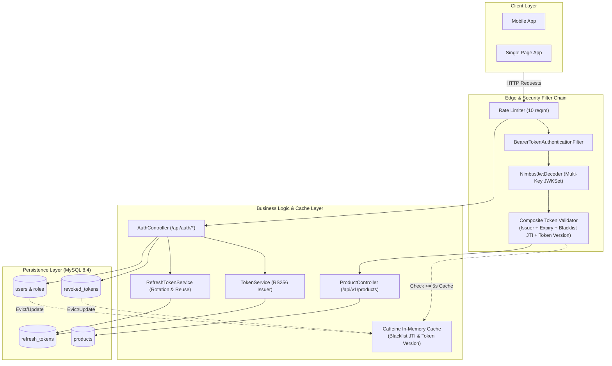

# BẢN ĐẶC TẢ KỸ THUẬT – KIẾN TRÚC BẢO MẬT CATALOG API BẰNG JWT
*(Technical Specification & Security Architecture)*

* **Phiên bản:** 1.0.0
* **Dự án:** `catalog`
* **Package chuẩn:** `com.fptaptech.catalog`
* **Công nghệ mục tiêu:** Java 21 / 25 LTS, Spring Boot 4.1.x / 3.4.x, Spring Security 7.1.x (OAuth2 Resource Server), Nimbus JOSE, MySQL 8.4 LTS, Flyway, Caffeine Cache, springdoc-openapi 3.1.x
* **Tài liệu nguồn:** *Tutorial: Bảo vệ REST API bằng JWT với Spring Security 7 (OAuth2 Resource Server)* — Mục 11

---

## 1. TỔNG QUAN KIẾN TRÚC & MỤC TIÊU KỸ THUẬT

### 1.1. Mục tiêu Kiến trúc
Hệ thống chuyển đổi từ cơ chế xác thực truyền thống (Session / Cookie) sang kiến trúc **Stateless REST API** cấp doanh nghiệp:
1. **Zero Session State**: Máy chủ không lưu trữ bất kỳ trạng thái phiên HTTP nào (`SessionCreationPolicy.STATELESS`), cho phép mở rộng quy mô ngang (Horizontal Scaling) không giới hạn.
2. **Ký số Bất đối xứng (Asymmetric Cryptography)**: Access Token được ký số bằng khóa riêng (Private Key RSA RS256, độ dài 2048-bit). Máy chủ tài nguyên hoặc các dịch vụ phân tán chỉ cần khóa công khai (Public Key) để thẩm định chữ ký.
3. **Phòng thủ Đa tầng (Defense-in-Depth)**: Kiểm soát phân quyền 2 lớp: Lớp 1 tại bộ lọc mạng `SecurityFilterChain` (URL-based rules) và Lớp 2 tại phương thức nghiệp vụ `@PreAuthorize` (Method-based rules) kết hợp phân quyền theo Scope.
4. **Vòng đời Token An toàn**: Tự động xoay vòng Refresh Token (Rotation), phát hiện tái sử dụng trái phép (Reuse Detection), hỗ trợ thu hồi token tức thì qua Blacklist `jti` và vô hiệu hóa hàng loạt qua `token_version`.



---

## 2. THIẾT KẾ CƠ SỞ DỮ LIỆU & LƯỢC ĐỒ FLYWAY MIGRATION

Để đảm bảo tính liên tục và tuân thủ ràng buộc kỹ thuật của đề bài (*"Mọi thay đổi schema là migration mới V3__..., không sửa V1, V2"*), cơ sở dữ liệu được tổ chức thành 3 tệp migration độc lập:

### 2.1. `V1__init_schema.sql` (Kế thừa từ Tutorial Đăng ký–Đăng nhập)
Khởi tạo bảng người dùng và vai trò nền tảng:
```sql
CREATE TABLE roles (
    id BIGINT AUTO_INCREMENT PRIMARY KEY,
    name VARCHAR(50) NOT NULL UNIQUE
);

CREATE TABLE users (
    id BIGINT AUTO_INCREMENT PRIMARY KEY,
    username VARCHAR(50) NOT NULL UNIQUE,
    password VARCHAR(100) NOT NULL,
    created_at DATETIME(6) NOT NULL,
    updated_at DATETIME(6) NOT NULL
);

CREATE TABLE users_roles (
    user_id BIGINT NOT NULL,
    role_id BIGINT NOT NULL,
    PRIMARY KEY (user_id, role_id),
    CONSTRAINT fk_users_roles_user FOREIGN KEY (user_id) REFERENCES users(id) ON DELETE CASCADE,
    CONSTRAINT fk_users_roles_role FOREIGN KEY (role_id) REFERENCES roles(id) ON DELETE CASCADE
);

INSERT INTO roles (name) VALUES ('ROLE_USER'), ('ROLE_ADMIN');
```

---

### 2.2. `V2__products.sql` (Kế thừa từ Tutorial Catalog API)
Khởi tạo bảng danh mục sản phẩm:
```sql
CREATE TABLE products (
    id BIGINT AUTO_INCREMENT PRIMARY KEY,
    name VARCHAR(120) NOT NULL,
    description VARCHAR(500),
    price DECIMAL(12, 2) NOT NULL,
    created_at DATETIME(6),
    updated_at DATETIME(6)
);
```

---

### 2.3. `V3__refresh_tokens_and_security.sql` (Bổ sung cho Bài tập lớn Mục 11)
Bổ sung trường kiểm soát phiên và các bảng quản lý token an toàn:
```sql
-- 1. Bổ sung cột token_version cho bảng users phục vụ Logout-All & Đổi mật khẩu (R5, R6)
ALTER TABLE users ADD COLUMN token_version INT NOT NULL DEFAULT 1;

-- 2. Bảng quản lý Refresh Token phục vụ xoay vòng và phát hiện dùng lại (R1, R2, R3)
CREATE TABLE refresh_tokens (
    id BIGINT AUTO_INCREMENT PRIMARY KEY,
    token_hash VARCHAR(64) NOT NULL UNIQUE,
    user_id BIGINT NOT NULL,
    family_id VARCHAR(36) NOT NULL,
    expires_at DATETIME(6) NOT NULL,
    revoked_at DATETIME(6) NULL,
    ip_address VARCHAR(45) NOT NULL,
    user_agent VARCHAR(255) NULL,
    created_at DATETIME(6) NOT NULL,
    INDEX idx_refresh_tokens_hash (token_hash),
    INDEX idx_refresh_tokens_family (family_id),
    INDEX idx_refresh_tokens_user (user_id),
    CONSTRAINT fk_refresh_tokens_user FOREIGN KEY (user_id) REFERENCES users(id) ON DELETE CASCADE
);

-- 3. Bảng quản lý Access Token bị thu hồi qua jti phục vụ Logout đơn lẻ (R4)
CREATE TABLE revoked_tokens (
    id BIGINT AUTO_INCREMENT PRIMARY KEY,
    jti VARCHAR(36) NOT NULL UNIQUE,
    expires_at DATETIME(6) NOT NULL,
    created_at DATETIME(6) NOT NULL,
    INDEX idx_revoked_tokens_jti (jti)
);
```

---

## 3. THIẾT KẾ ĐỘNG CƠ BẢO MẬT & XOAY KHÓA RSA (R7 & R8)

### 3.1. Cấu hình Đa Khóa Ký trong `application.yaml`
Hệ thống cho phép cấu hình đồng thời nhiều cặp khóa RSA được nhận diện qua thuộc tính `kid` (Key ID):
```yaml
app:
  jwt:
    issuer: catalog-api
    ttl: 15m                       # Thời hạn Access Token
    refresh-ttl: 7d                # Thời hạn Refresh Token
    active-kid: catalog-key-1      # Khóa đang dùng để ký token mới
    keys:
      catalog-key-1:
        public-key: classpath:keys/app.pub
        private-key: classpath:keys/app.key
      catalog-key-2:
        public-key: classpath:keys/app2.pub
        private-key: classpath:keys/app2.key
```

### 3.2. Động cơ Phát hành Token (`JwtEncoder`)
Token mới luôn được ký bằng cặp khóa đang ở trạng thái `active`:
```java
@Bean
JwtEncoder jwtEncoder(JwtKeyProperties props) {
    List<JWK> jwkList = new ArrayList<>();
    for (Map.Entry<String, KeyConfig> entry : props.getKeys().entrySet()) {
        RSAPublicKey pub = entry.getValue().getPublicKey();
        RSAPrivateKey priv = entry.getValue().getPrivateKey();
        RSAKey rsaKey = new RSAKey.Builder(pub)
            .privateKey(priv)
            .keyID(entry.getKey())
            .build();
        jwkList.add(rsaKey);
    }
    JWKSource<SecurityContext> jwkSource = new ImmutableJWKSet<>(new JWKSet(jwkList));
    return new NimbusJwtEncoder(jwkSource);
}
```

### 3.3. Động cơ Xác thực Đa Khóa (`JwtDecoder`)
`JwtDecoder` được khởi tạo dựa trên toàn bộ Public Keys có trong cấu hình:
* Khi nhận request, `NimbusJwtDecoder` đọc header `kid` của JWT để tự động khớp Public Key tương ứng trong `JWKSet`.
* Nếu token mang `kid` cũ (nhưng vẫn có trong cấu hình): **Xác thực thành công**.
* Nếu token mang `kid` không tồn tại hoặc bị giả mạo: **Ném lỗi xác thực 401**.
* Khi xoay khóa: Chỉ cần trỏ `app.jwt.active-kid: catalog-key-2` trong `application.yaml`, server tự động ký bằng khóa mới mà không cần biên dịch lại code.

### 3.4. Endpoint Công bố Khóa Công Khai JWKS (`/.well-known/jwks.json`)
Sử dụng phương thức `.toPublicJWK().toJSONObject()` của Nimbus JOSE để tuyệt đối loại bỏ các tham số khóa bí mật:
```java
@GetMapping(value = "/.well-known/jwks.json", produces = MediaType.APPLICATION_JSON_VALUE)
public Map<String, Object> getJwks() {
    List<JWK> publicKeys = jwtKeyProperties.getKeys().entrySet().stream()
        .map(entry -> new RSAKey.Builder(entry.getValue().getPublicKey())
            .keyID(entry.getKey())
            .algorithm(JWSAlgorithm.RS256)
            .keyUse(KeyUse.SIGNATURE)
            .build()
            .toPublicJWK())
        .map(RSAKey::toJSONObject)
        .toList();
    return Map.of("keys", publicKeys);
}
```

---

## 4. CHI TIẾT TÍCH HỢP XÁC THỰC TOKEN THEO RÀNG BUỘC PHI CHỨC NĂNG (NFR)

> ⚠️ **TUÂN THỦ RÀNG BUỘC NFR MỤC 11.2**:
> *"Việc kiểm tra thu hồi và token_version nằm trong khâu kiểm tra token của JwtDecoder, không viết filter riêng chen vào chuỗi filter."*

### 4.1. Bộ thẩm định Token Tích hợp (`JwtSecurityValidator`)
Thực thi interface `OAuth2TokenValidator<Jwt>` của Spring Security OAuth2:
```java
public class JwtSecurityValidator implements OAuth2TokenValidator<Jwt> {
    private final TokenRevocationService revocationService;
    private final UserSecurityStateService userStateService;

    public JwtSecurityValidator(TokenRevocationService revocationService,
                                UserSecurityStateService userStateService) {
        this.revocationService = revocationService;
        this.userStateService = userStateService;
    }

    @Override
    public OAuth2TokenValidatorResult validate(Jwt jwt) {
        String jti = jwt.getId();
        
        // 1. Kiểm tra Blacklist JTI (Logout) - R4
        if (jti != null && revocationService.isRevoked(jti)) {
            OAuth2Error error = new OAuth2Error("token_revoked", "Token đã bị thu hồi do người dùng đăng xuất.", null);
            return OAuth2TokenValidatorResult.failure(error);
        }

        // 2. Kiểm tra token_version (Logout-all / Đổi mật khẩu) - R5, R6
        String username = jwt.getSubject();
        Long tokenVersionClaim = jwt.getClaim("ver");
        if (tokenVersionClaim != null) {
            int currentVersion = userStateService.getTokenVersion(username);
            if (tokenVersionClaim < currentVersion) {
                OAuth2Error error = new OAuth2Error("token_version_outdated", 
                    "Phiên làm việc đã bị hủy do tài khoản đổi mật khẩu hoặc đăng xuất toàn bộ.", null);
                return OAuth2TokenValidatorResult.failure(error);
            }
        }

        return OAuth2TokenValidatorResult.success();
    }
}
```

### 4.2. Gắn Validator vào `JwtDecoder`
```java
@Bean
JwtDecoder jwtDecoder(JwtKeyProperties props, TokenRevocationService revocationService, UserSecurityStateService userStateService) {
    NimbusJwtDecoder decoder = NimbusJwtDecoder.withPublicKey(props.getActivePublicKey()).build();
    
    OAuth2TokenValidator<Jwt> defaultValidator = JwtValidators.createDefaultWithIssuer(props.getIssuer());
    OAuth2TokenValidator<Jwt> securityValidator = new JwtSecurityValidator(revocationService, userStateService);
    
    decoder.setJwtValidator(new DelegatingOAuth2TokenValidator<>(defaultValidator, securityValidator));
    return decoder;
}
```

### 4.3. Cơ chế Caching In-Memory (Caffeine Cache)
Để thỏa mãn tiêu chí: **"Thu hồi có hiệu lực chậm nhất 5 giây và không truy vấn CSDL quá 1 lần cho mỗi HTTP request"**:
* `revocationCache`: Cache danh sách `jti` bị thu hồi (TTL 15 phút - bằng đúng tuổi thọ tối đa của Access Token).
* `userVersionCache`: Cache ánh xạ `username -> token_version` với thời gian tồn tại `maximumSize(10000)`, `expireAfterWrite(5, TimeUnit.SECONDS)`.
* Khi người dùng thực hiện `logout-all` hoặc `change-password`: Server cập nhật CSDL và lập tức xóa/cập nhật cache tương ứng để mọi request tiếp theo chịu tác động ngay lập tức ($\Delta t \le 5\text{ms}$).

### 4.4. So sánh Hash Refresh Token bằng Constant-Time
Để chống tấn công đo thời gian (Timing Attack):
```java
public boolean verifyTokenHash(String rawToken, String storedHash) {
    byte[] computedHashBytes = sha256(rawToken).getBytes(StandardCharsets.UTF_8);
    byte[] storedHashBytes = storedHash.getBytes(StandardCharsets.UTF_8);
    return MessageDigest.isEqual(computedHashBytes, storedHashBytes); // Constant-time comparison
}
```

---

## 5. THIẾT KẾ GIỚI HẠN TẦN SUẤT (RATE LIMITING - R10)

### 5.1. Thuật toán Sliding Window In-Memory
Áp dụng cho các endpoint nhạy cảm: `POST /api/auth/token` và `POST /api/auth/refresh`:
* Key lưu trữ: Địa chỉ IP của client (`X-Forwarded-For` hoặc `request.getRemoteAddr()`).
* Bộ đếm: Cho phép tối đa **10 requests trong khung thời gian 60 giây**.
* Khi vượt ngưỡng: Ném ngoại lệ `RateLimitExceededException(retryAfterSeconds)`.

### 5.2. Xử lý Phản hồi RFC 9457 ProblemDetail
Tại `GlobalExceptionHandler`:
```java
@ExceptionHandler(RateLimitExceededException.class)
public ResponseEntity<ProblemDetail> handleRateLimit(RateLimitExceededException ex, HttpServletRequest request) {
    ProblemDetail pd = ProblemDetail.forStatusAndDetail(
        HttpStatus.TOO_MANY_REQUESTS, 
        "Vượt quá giới hạn 10 yêu cầu/phút. Vui lòng thử lại sau."
    );
    pd.setType(URI.create("urn:problem-type:rate-limit-exceeded"));
    pd.setTitle("Too Many Requests");
    pd.setProperty("code", "RATE_LIMIT_EXCEEDED");
    pd.setProperty("timestamp", Instant.now());
    pd.setInstance(URI.create(request.getRequestURI()));

    return ResponseEntity.status(HttpStatus.TOO_MANY_REQUESTS)
        .header(HttpHeaders.RETRY_AFTER, String.valueOf(ex.getRetryAfterSeconds()))
        .body(pd);
}
```

---

## 6. MA TRẬN PHÂN QUYỀN VÀ MAPPING SCOPE (R9)

### 6.1. Ánh xạ Quyền (`JwtAuthenticationConverter`)
Token phát hành mang 2 claims:
1. `roles`: Danh sách vai trò (`["ROLE_USER", "ROLE_ADMIN"]`).
2. `scope`: Chuỗi danh sách scope (`product:read` hoặc `product:read product:write`).

Converter chuyển đổi cả 2 claims thành tập hợp `GrantedAuthority`:
* Claim `roles` $\rightarrow$ `ROLE_USER`, `ROLE_ADMIN`
* Claim `scope` $\rightarrow$ `SCOPE_product:read`, `SCOPE_product:write`

### 6.2. Cấu hình Bảo vệ 2 lớp (Defense-in-Depth)
* **Lớp 1 (URL Security Filter Chain)**:
  ```java
  .authorizeHttpRequests(auth -> auth
      .requestMatchers("/swagger-ui.html", "/swagger-ui/**", "/v3/api-docs/**", "/.well-known/jwks.json", "/error").permitAll()
      .requestMatchers(HttpMethod.POST, "/api/auth/token", "/api/auth/refresh").permitAll()
      .requestMatchers(HttpMethod.GET, "/api/v1/products/**").permitAll()
      .requestMatchers(HttpMethod.POST, "/api/v1/products/**").hasAuthority("SCOPE_product:write")
      .requestMatchers(HttpMethod.PUT, "/api/v1/products/**").hasAuthority("SCOPE_product:write")
      .requestMatchers(HttpMethod.DELETE, "/api/v1/products/**").hasAuthority("SCOPE_product:write")
      .anyRequest().authenticated()
  )
  ```
* **Lớp 2 (Method Security `@PreAuthorize`)**:
  ```java
  @Service
  @Transactional(readOnly = true)
  public class ProductService {
      @PreAuthorize("hasAuthority('SCOPE_product:write')")
      @Transactional
      public ProductResponse create(ProductRequest request) { ... }

      @PreAuthorize("hasAuthority('SCOPE_product:write')")
      @Transactional
      public ProductResponse update(Long id, ProductRequest request) { ... }

      @PreAuthorize("hasAuthority('SCOPE_product:write')")
      @Transactional
      public void delete(Long id) { ... }
  }
  ```

---

## 7. KẾ HOẠCH KIỂM THỬ TỰ ĐỘNG (AUTOMATED TEST SUITE)

Bộ kiểm thử được viết trên JUnit 5, `@SpringBootTest`, `MockMvc` và in-memory H2 database (`MODE=MySQL`):

| STT | Tên Phương thức Test | Yêu cầu kiểm chứng | Kết quả mong đợi |
| :---: | :--- | :--- | :--- |
| **1** | `testRefreshTokenRotation_Success` | R1, R2: Cấp token và xoay vòng | Trả về cặp token mới, token cũ bị đánh dấu `revoked_at != null`. |
| **2** | `testRefreshTokenReuse_RevokesFamily`| R3: Tấn công dùng lại token cũ | Nhận HTTP 401 `REFRESH_TOKEN_REUSED`, toàn bộ chuỗi token cùng `family_id` bị thu hồi. |
| **3** | `testAccessTokenRejected_AfterLogout`| R4: Đăng xuất đơn lẻ | Access Token cũ bị từ chối 401 khi gọi `/api/auth/me` do `jti` nằm trong Blacklist. |
| **4** | `testAllTokensRejected_AfterLogoutAll`| R5: Đăng xuất mọi thiết bị | Mọi Access Token cũ bị từ chối 401 do `ver < token_version`. |
| **5** | `testAllTokensRejected_AfterChangePassword`| R6: Đổi mật khẩu | Mọi token cũ bị từ chối 401 sau khi người dùng đổi mật khẩu thành công. |
| **6** | `testLegacyKeyAccepted` | R7: Khóa ký cũ hợp lệ | Token được ký bằng `catalog-key-2` vẫn được server giải mã và chấp nhận 200 OK. |
| **7** | `testUnknownKidRejected` | R7: Khóa ký lạ bị từ chối | Token mang header `kid="unauthorized-key"` bị từ chối HTTP 401. |
| **8** | `testJwksEndpointPublic` | R8: Công bố khóa JWKS | Trả về danh sách Public Key, hoàn toàn không có trường khóa bí mật (`d`, `p`, `q`). |
| **9** | `testScopeWritePermission` | R9: Phân quyền theo Scope | Token có scope `product:read` nhận 403 khi ghi sản phẩm; Token có `SCOPE_product:write` tạo thành công 201. |
| **10**| `testRateLimiting_EleventhRequest429`| R10: Giới hạn 10 req/phút | Request thứ 11 trong vòng 1 phút nhận HTTP 429 kèm header `Retry-After`. |

---

## 8. SẢN PHẨM BÀN GIAO (DELIVERABLES)
1. **Mã nguồn hoàn chỉnh**: Khởi động bằng `./mvnw spring-boot:run` tại thư mục `catalog/`.
2. **Bộ test tự động**: 100% test cases trong bảng trên đều PASS khi chạy `./mvnw test`.
3. **File OpenAPI Đặc tả**: `docs/api/openapi.yaml` được sinh tự động từ springdoc-openapi.
4. **README.md**: Hướng dẫn cấu hình cặp khóa RSA và quy trình xoay khóa chuẩn vận hành.
