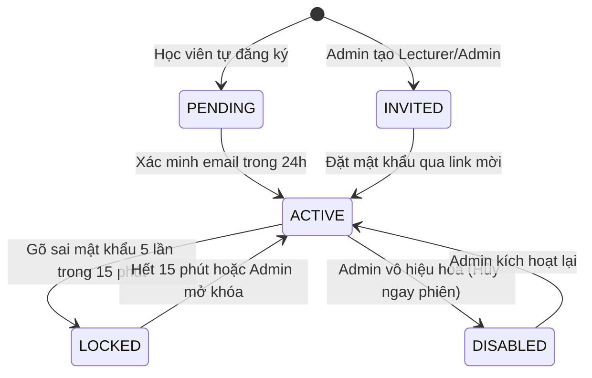

# Bản Đặc tả kỹ thuật: Cổng tài khoản học viên FPT Aptech
*(Technical Specification & Security Architecture)*

* **Phiên bản:** 1.0.0
* **Dự án:** `fpt-aptech-auth`
* **Tiêu chuẩn áp dụng:** Spring Security 6.4/7 Lambda DSL, RFC 6238 (TOTP), RFC 9457, OWASP Top 10, STRIDE Threat Model
* **Môi trường mục tiêu:** Java 21 LTS, Spring Boot 3.4.x, MySQL 8.4, Docker Compose

---

## 1. Mục tiêu & Các bên liên quan (Stakeholder Context)

### 1.1 Người dùng & Vai trò trong hệ thống
Hệ thống quản lý định danh phân chia người dùng thành 3 vai trò rõ rệt:

1. **`ROLE_STUDENT` (Học viên):**
   * Được phép tự đăng ký tài khoản qua cổng Web với email hợp lệ.
   * Cần bấm vào link kích hoạt trong 24h để kích hoạt tài khoản từ trạng thái `PENDING` sang `ACTIVE`.
   * Tùy chọn bật xác thực 2 bước (2FA Google Authenticator) để bảo vệ tài khoản.
   * Xem và chỉnh sửa thông tin cá nhân, thực hiện đổi mật khẩu định kỳ.
   * Xem danh sách các thiết bị/phiên đang đăng nhập của mình và có quyền đăng xuất từ xa từng phiên.
2. **`ROLE_LECTURER` (Giảng viên):**
   * Không thể tự đăng ký tài khoản. Chỉ có `ADMIN` mới có quyền tạo và gửi email mời (`INVITED`).
   * Bắt buộc phải thiết lập 2FA (TOTP) ngay sau lần đăng nhập đầu tiên mới được phép truy cập vào hệ thống.
   * Được xem danh sách học viên trong hệ thống ở chế độ chỉ đọc (Read-only).
3. **`ROLE_ADMIN` (Quản trị viên):**
   * Quản lý toàn bộ người dùng: tìm kiếm theo email, phân trang, lọc theo vai trò và trạng thái.
   * Thực hiện các tác vụ quản trị: Khóa/Mở khóa tài khoản, Vô hiệu hóa tài khoản (`DISABLED` - lập tức hủy mọi phiên đăng nhập của tài khoản đó), gán quyền vai trò.
   * Mời Giảng viên hoặc Quản trị viên mới vào hệ thống qua email.
   * Xem và tra cứu Nhật ký kiểm toán (Audit Logs) với đầy đủ thông tin: IP, User-Agent, hành động, thời điểm.
   * **Quy tắc an ninh bắt buộc:** Hệ thống luôn phải duy trì ít nhất 1 ADMIN đang hoạt động (`ACTIVE`) và ADMIN không thể tự gỡ quyền ADMIN của chính mình.

---

## 2. Mô hình vòng đời tài khoản (5 Trạng thái)



* **Quy tắc đăng nhập:** Chỉ có tài khoản ở trạng thái `ACTIVE` mới được phép đăng nhập. Tất cả các tài khoản ở trạng thái khác (`PENDING`, `INVITED`, `LOCKED`, `DISABLED`) khi đăng nhập đều nhận cùng một thông báo lỗi chung để bảo mật.
* **Quy tắc hủy phiên:** Khi tài khoản bị chuyển sang `DISABLED`, hệ thống lập tức thu hồi và xóa toàn bộ session đang hoạt động cùng các token Remember-Me tương ứng.

---

## 3. Chi tiết Tiêu chí Kỹ thuật (Acceptance Criteria F1 – F11)

### F1: Đăng ký tài khoản bằng email
* Form đăng ký yêu cầu: Username, Email, Mật khẩu, Nhập lại mật khẩu.
* Tài khoản mới tạo được gán trạng thái `PENDING`, chưa thể đăng nhập.
* Hệ thống sinh token ngẫu nhiên an toàn (SecureRandom 32 bytes), lưu băm SHA-256 vào database, đồng thời gửi email chứa link dạng: `http://localhost:8080/verify-email?token={token}`.

### F2: Xác minh email
* Token có hiệu lực trong 24 giờ và chỉ được sử dụng đúng 1 lần.
* Khi người dùng nhấp link, hệ thống kiểm tra token:
  * Nếu hợp lệ: Cập nhật trạng thái user thành `ACTIVE`, ghi nhận thời gian `used_at`, và tự động đăng nhập (Auto-login) chuyển hướng về trang chủ `/`.
  * Nếu hết hạn hoặc đã dùng: Hiển thị thông báo lỗi rõ ràng và cung cấp nút "Gửi lại link xác minh".
* Giới hạn tần suất gửi lại: Tối đa 3 lần mỗi giờ cho một email.

### F3: Quên mật khẩu & Khôi phục
* Người dùng nhập email tại `/forgot-password`.
* Hệ thống gửi email chứa link đặt lại mật khẩu có hiệu lực trong 30 phút (token dùng 1 lần).
* **Chống lộ email (Blind Response):** Bất kể email có tồn tại trong hệ thống hay không, giao diện web luôn trả về cùng một thông điệp: *"Nếu email của bạn tồn tại trong hệ thống, chúng tôi đã gửi liên kết đặt lại mật khẩu"*.
* Đặt lại mật khẩu thành công: Mọi phiên làm việc cũ trên tất cả các thiết bị đều bị hủy ngay lập tức.

### F4: Chính sách mật khẩu nghiêm ngặt
Form kiểm tra mật khẩu tuân thủ 4 quy tắc:
1. **Độ dài:** Tối thiểu 12 ký tự (tối đa 64 ký tự).
2. **Ngăn chặn thông tin cá nhân:** Không được chứa username hoặc phần local part của email.
3. **Chống mật khẩu phổ biến:** Đối chiếu với từ điển 10.000 mật khẩu phổ biến nhất thế giới (`common-passwords-10k.txt`). Nếu trùng sẽ bị từ chối ngay.
4. **Lịch sử mật khẩu:** Lưu lịch sử băm của 5 mật khẩu gần nhất trong bảng `password_history`. Không cho phép tái sử dụng bất kỳ mật khẩu nào trong số này.

### F5: Khóa tài khoản tạm thời & Chống Timing Attack
* **Brute-force Lockout:** Nếu người dùng nhập sai mật khẩu 5 lần liên tiếp trong khoảng thời gian 15 phút, tài khoản lập tức bị chuyển sang trạng thái `LOCKED` trong 15 phút.
* **Thông báo an toàn:** Thông báo lỗi đăng nhập không tiết lộ tài khoản có tồn tại trong database hay không (thông báo chung: *"Tên đăng nhập hoặc mật khẩu không chính xác"* hoặc *"Tài khoản tạm thời bị khóa"*).
* **Phòng chống Timing Attack:** Khi xử lý `POST /login`, nếu username không tồn tại, hệ thống vẫn thực thi một phép tính băm giả lập (`BCrypt.checkpw` với hash chuẩn) để độ lệch thời gian phản hồi giữa user có thật (sai pass) và user không tồn tại chênh nhau không quá $50\text{ ms}$.

### F6: Xác thực 2 bước (TOTP - RFC 6238)
* Triển khai chuẩn TOTP RFC 6238 (mã số 6 chữ số, chu kỳ làm mới 30 giây).
* Sinh mã bí mật (Secret Key) và hiển thị QR Code dạng Data URI (`data:image/png;base64,...`) trên trang `/2fa/setup`.
* Sinh 10 mã khôi phục (Recovery Codes) dùng 1 lần để người dùng lưu lại phòng khi mất thiết bị.
* Secret Key được mã hóa bằng thuật toán đối xứng AES-GCM với khóa 256-bit lấy từ biến môi trường trước khi lưu vào database.
* Đối với vai trò `LECTURER` và `ADMIN`: Nếu chưa kích hoạt 2FA, sau khi nhập đúng mật khẩu, hệ thống sẽ chặn truy cập các trang khác và bắt buộc chuyển hướng vào `/2fa/setup`.

### F7: Ghi nhớ đăng nhập an toàn (Remember-Me)
* Sử dụng `PersistentTokenBasedRememberMeServices` lưu token trong database (`persistent_logins`).
* Hiệu lực: 14 ngày.
* Khi người dùng đổi mật khẩu hoặc bị vô hiệu hóa, toàn bộ token remember-me tương ứng bị hủy ngay.

### F8: Quản lý phiên đồng thời (Spring Session JDBC)
* Sử dụng `Spring Session JDBC` lưu trữ phiên đăng nhập trong bảng `SPRING_SESSION`.
* Giới hạn tối đa **2 phiên đồng thời** cho mỗi tài khoản.
* Khi đăng nhập trên thiết bị thứ 3, hệ thống tự động hủy (kick) phiên cũ nhất.
* Cung cấp trang giao diện `/sessions` ("Thiết bị đăng nhập"):
  * Hiển thị danh sách các phiên đang chạy: Thời điểm đăng nhập/truy cập gần nhất, Địa chỉ IP, Trình duyệt/Thiết bị (phân tích từ Header `User-Agent`).
  * Có nút "Đăng xuất" cho phép người dùng chủ động hủy phiên từ xa.

### F9: Đổi mật khẩu trong phiên đăng nhập
* Yêu cầu người dùng nhập đúng mật khẩu hiện tại trước khi đặt mật khẩu mới.
* Mật khẩu mới phải thỏa mãn toàn bộ tiêu chí chính sách mật khẩu (F4).
* Khi đổi mật khẩu thành công: Phiên làm việc hiện tại được giữ nguyên, nhưng toàn bộ các phiên khác trên các thiết bị khác đều bị hủy bỏ.

### F10: Quản trị tài khoản (Dành cho Quản trị viên)
* Giao diện `/admin/users`:
  * Danh sách người dùng phân trang (10 bản ghi/trang).
  * Bộ lọc linh hoạt: Lọc theo vai trò (`STUDENT`, `LECTURER`, `ADMIN`), lọc theo trạng thái (`PENDING`, `INVITED`, `ACTIVE`, `LOCKED`, `DISABLED`), tìm kiếm theo email.
  * Các nút thao tác nhanh: Khóa / Mở khóa, Vô hiệu hóa, Kích hoạt lại, Buộc đăng xuất (hủy session ngay lập tức).
* Giao diện `/admin/invite`: Cho phép Admin tạo tài khoản `LECTURER` hoặc `ADMIN` mới và gửi email mời kích hoạt.
* **Chốt chặn an toàn (Guard Rails):**
  * Không cho phép xóa hoặc hạ quyền nếu hệ thống chỉ còn duy nhất 1 ADMIN đang `ACTIVE`.
  * Không cho phép một ADMIN tự gỡ bỏ quyền ADMIN của chính mình.

### F11: Nhật ký kiểm toán (Audit Logging)
* Ghi nhận tự động vào bảng `audit_logs` đối với các sự kiện:
  * Đăng nhập thành công, Đăng nhập thất bại.
  * Đăng xuất, Buộc đăng xuất.
  * Khóa tài khoản, Mở khóa tài khoản.
  * Đổi mật khẩu, Quên mật khẩu.
  * Thay đổi vai trò, Kích hoạt / Vô hiệu hóa 2FA.
* Mỗi bản ghi lưu trữ: `id`, `event_time`, `email`, `action`, `ip_address`, `user_agent`, `status`, `details`.
* Giao diện `/admin/audit-logs` cho phép Quản trị viên tra cứu, tìm kiếm và lọc nhật ký theo thời gian và hành động.

---

## 4. Mô hình cơ sở dữ liệu (Flyway Schema)

```sql
-- V1__init_schema.sql

CREATE TABLE roles (
    id BIGINT AUTO_INCREMENT PRIMARY KEY,
    name VARCHAR(50) NOT NULL UNIQUE
);

CREATE TABLE users (
    id BIGINT AUTO_INCREMENT PRIMARY KEY,
    email VARCHAR(100) NOT NULL UNIQUE,
    username VARCHAR(50) NOT NULL UNIQUE,
    password_hash VARCHAR(100) NOT NULL,
    status VARCHAR(20) NOT NULL DEFAULT 'PENDING',
    failed_attempts INT NOT NULL DEFAULT 0,
    locked_until DATETIME(6) NULL,
    totp_secret VARCHAR(255) NULL,
    totp_enabled BOOLEAN NOT NULL DEFAULT FALSE,
    created_at DATETIME(6) NOT NULL,
    updated_at DATETIME(6) NOT NULL
);

CREATE TABLE users_roles (
    user_id BIGINT NOT NULL,
    role_id BIGINT NOT NULL,
    PRIMARY KEY (user_id, role_id),
    CONSTRAINT fk_users_roles_user FOREIGN KEY (user_id) REFERENCES users(id) ON DELETE CASCADE,
    CONSTRAINT fk_users_roles_role FOREIGN KEY (role_id) REFERENCES roles(id) ON DELETE CASCADE
);

CREATE TABLE tokens (
    id BIGINT AUTO_INCREMENT PRIMARY KEY,
    token_hash VARCHAR(64) NOT NULL UNIQUE,
    token_type VARCHAR(30) NOT NULL,
    user_id BIGINT NOT NULL,
    expires_at DATETIME(6) NOT NULL,
    used_at DATETIME(6) NULL,
    created_at DATETIME(6) NOT NULL,
    CONSTRAINT fk_tokens_user FOREIGN KEY (user_id) REFERENCES users(id) ON DELETE CASCADE
);

CREATE TABLE password_history (
    id BIGINT AUTO_INCREMENT PRIMARY KEY,
    user_id BIGINT NOT NULL,
    password_hash VARCHAR(100) NOT NULL,
    created_at DATETIME(6) NOT NULL,
    CONSTRAINT fk_password_history_user FOREIGN KEY (user_id) REFERENCES users(id) ON DELETE CASCADE
);

CREATE TABLE recovery_codes (
    id BIGINT AUTO_INCREMENT PRIMARY KEY,
    user_id BIGINT NOT NULL,
    code_hash VARCHAR(64) NOT NULL,
    used BOOLEAN NOT NULL DEFAULT FALSE,
    used_at DATETIME(6) NULL,
    CONSTRAINT fk_recovery_codes_user FOREIGN KEY (user_id) REFERENCES users(id) ON DELETE CASCADE
);

CREATE TABLE audit_logs (
    id BIGINT AUTO_INCREMENT PRIMARY KEY,
    event_time DATETIME(6) NOT NULL,
    email VARCHAR(100) NOT NULL,
    action VARCHAR(50) NOT NULL,
    ip_address VARCHAR(45) NOT NULL,
    user_agent VARCHAR(255) NULL,
    status VARCHAR(20) NOT NULL,
    details TEXT NULL
);

CREATE TABLE persistent_logins (
    series VARCHAR(64) PRIMARY KEY,
    username VARCHAR(64) NOT NULL,
    token VARCHAR(64) NOT NULL,
    last_used TIMESTAMP NOT NULL
);
```

---

## 5. Danh mục Kiểm thử & Tiêu chí nghiệm thu chi tiết

```
Testing Pyramid:
▲ E2E Web Flow Tests (~10 tests)
  - Full registration -> Mail verification -> Auto-login
  - Reset password with token flow -> Session invalidation
  - 2FA setup & login with OTP
■ Integration Tests (~18 tests)
  - Account Lockout after 5 failed attempts
  - Timing attack response delta measurement (<= 50ms)
  - Concurrent session limit = 2 (oldest session kicked)
  - Admin rules: Last admin guard & self-demote guard
  - Audit logging verification on security events
● Unit Tests (~12 tests)
  - Password policy validation (length, dictionary, history)
  - TOTP code generation & validation (RFC 6238)
```

---

## 6. Hướng dẫn khởi động & Sử dụng

### 6.1 Khởi động hạ tầng Docker
```bash
docker compose up -d
```
* **MySQL 8.4:** Port `3307:3306` (Database: `auth`, User: `auth`, Password: `auth_pw`)
* **Mailpit:** Web UI xem email tại `http://localhost:8025`, SMTP tại cổng `1025`

### 6.2 Khởi động ứng dụng
```bash
./mvnw spring-boot:run
```
* **Trang chủ:** `http://localhost:8080/`
* **Tài khoản Quản trị khởi tạo:** `admin@fpt.edu.vn` / `Admin@Aptech2026!`
